# ARSW Lab - Parte 2

## Escalabilidad horizontal con Azure Load Balancer

### Resumen

Se implementó una arquitectura de escalabilidad horizontal para `FibonacciApp` en Microsoft Azure. La solución utiliza un Load Balancer público, una red virtual y tres máquinas virtuales distribuidas en las zonas de disponibilidad 1, 2 y 3 de Chile Central. La validación funcional y las pruebas de carga se realizaron sobre la IP pública del balanceador.

## 1. Infraestructura desplegada

El despliegue se realizó en el grupo de recursos `ARSW-LAB-PARTE2`, región **Chile Central**. La red virtual conecta las tres máquinas virtuales con el balanceador de carga público.

| Recurso | Configuración o función |
| --- | --- |
| Resource Group | `ARSW-LAB-PARTE2` |
| Virtual Network | `ARSW-VNet`, con una subnet `default` |
| Load Balancer | `ARSW-LB`, SKU Standard, público y regional |
| IP pública del Load Balancer | `68.211.135.225` |
| Backend Pool | `ARSW-BackendPool`, con VM1, VM2 y VM3 |
| Health Probe | `ARSW-HealthProbe`, TCP sobre el puerto 3000 |
| Load Balancing Rule | Puerto público 80 hacia el puerto 3000 de los nodos |
| Network Security Group | `ARSW-VM-NSG`, con reglas para SSH y la aplicación |
| Nodos | VM1 en zona 1, VM2 en zona 2 y VM3 en zona 3 |

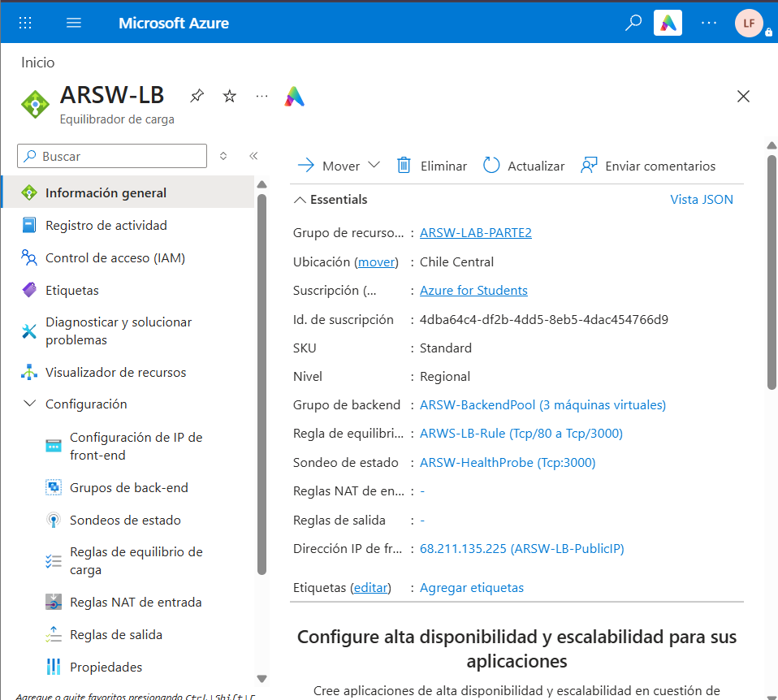

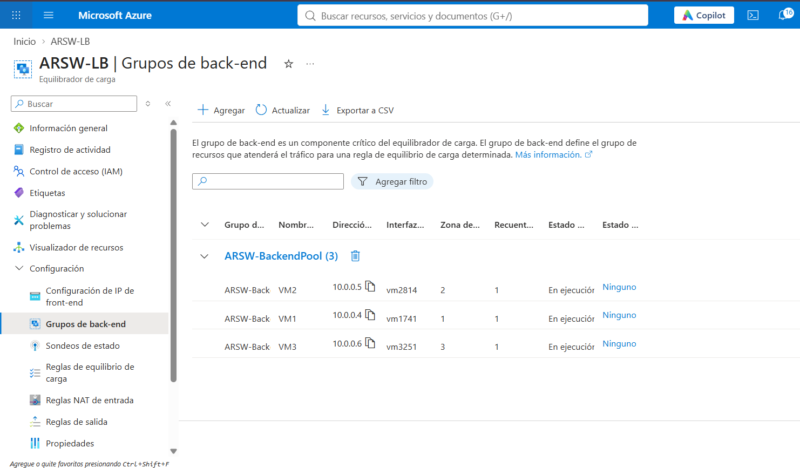

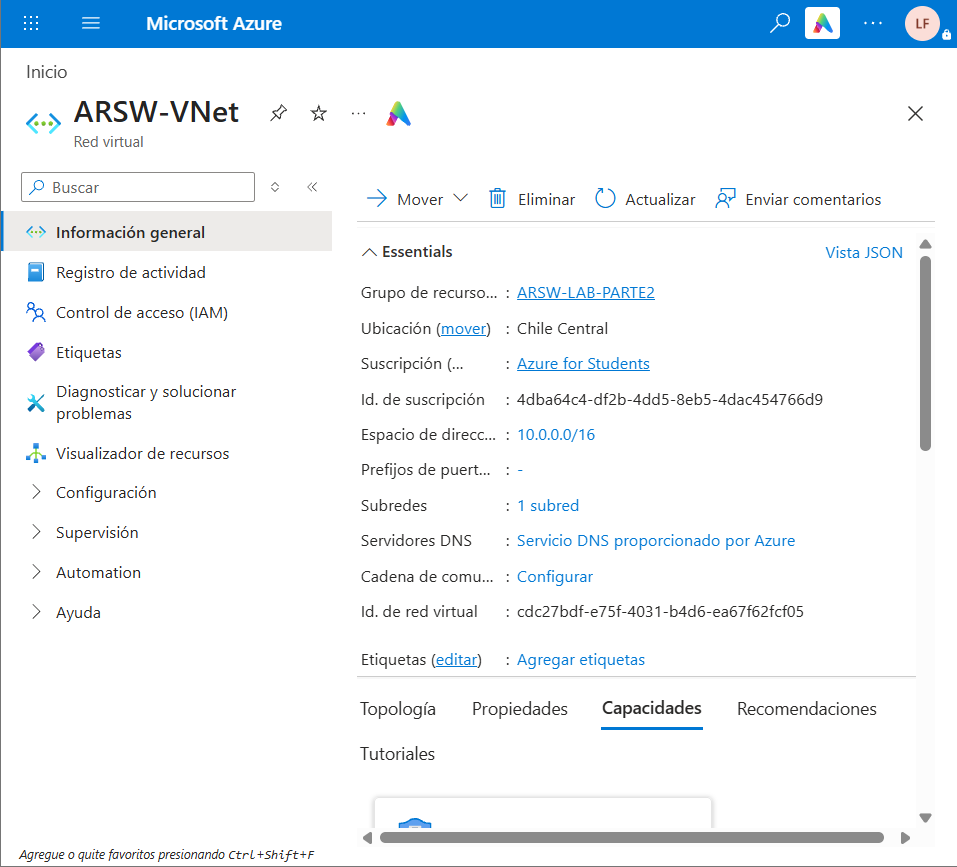

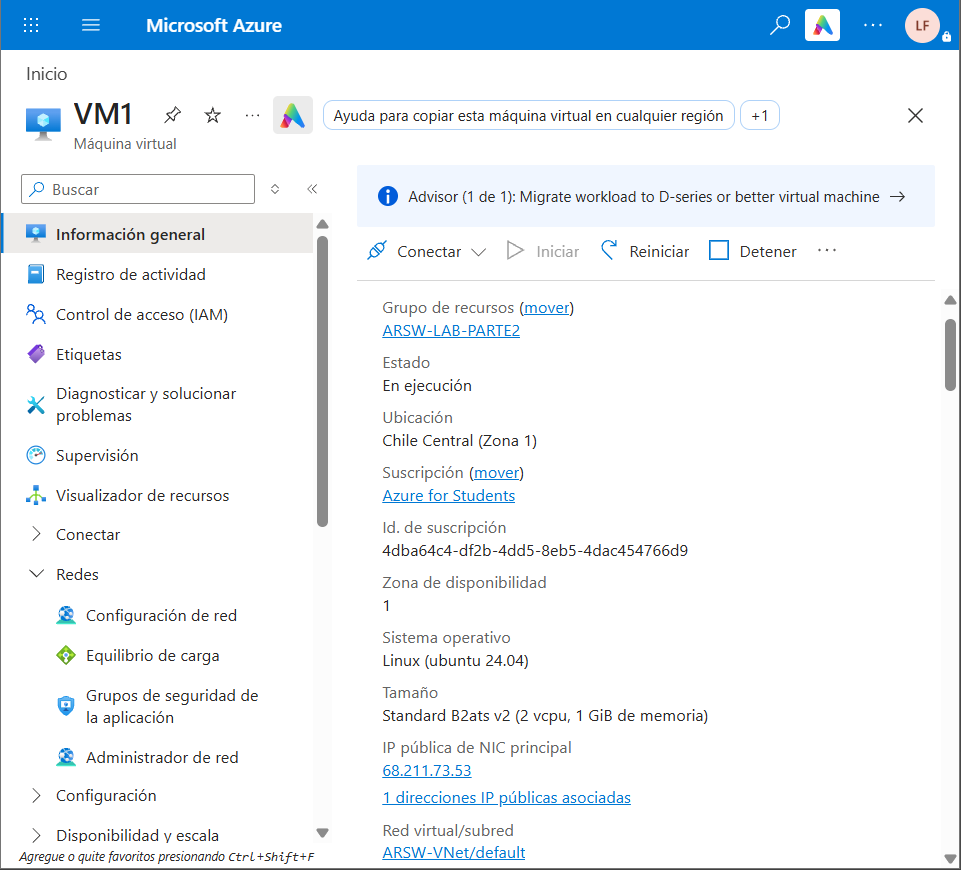

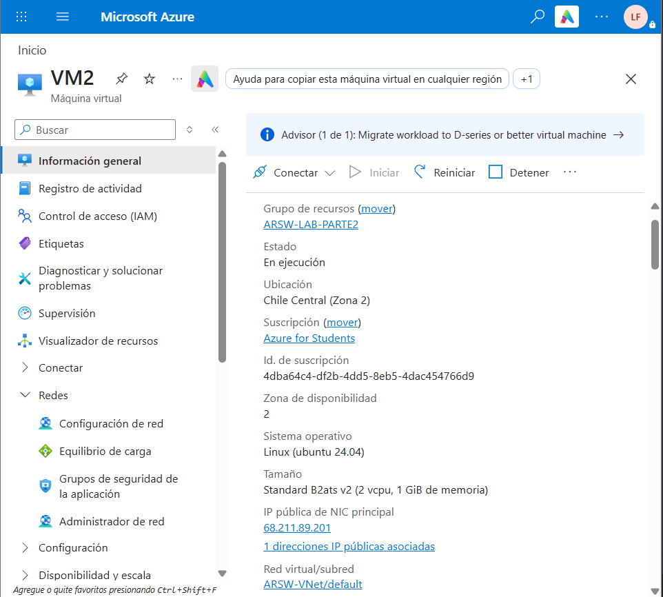

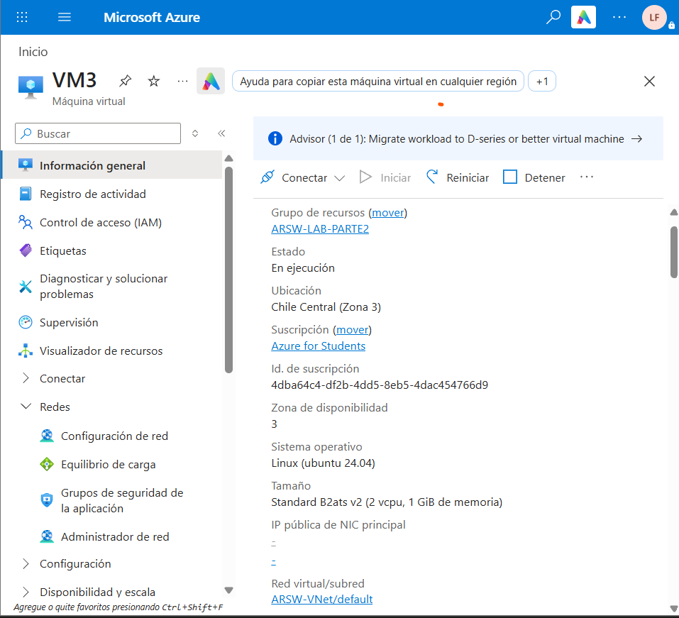

## 2. Tipos de balanceadores de carga en Azure

Azure ofrece diferentes servicios para distribuir tráfico, pero no todos resuelven el mismo problema:

| Servicio | Capa principal | Uso |
| --- | --- | --- |
| Azure Load Balancer | Capa 4, TCP/UDP | Distribuir conexiones entre máquinas virtuales o instancias por IP y puerto |
| Application Gateway | Capa 7, HTTP/HTTPS | Balanceo web con terminación TLS, enrutamiento por URL o dominio y WAF |
| Azure Front Door | Capa 7, global | Distribución HTTP/HTTPS entre regiones, aceleración y entrada global |
| Traffic Manager | DNS | Selección de endpoints mediante DNS, útil para distribución global y recuperación ante fallos |
| Application Gateway for Containers | Capa 7 | Enrutamiento de aplicaciones que se ejecutan en Azure Kubernetes Service |

La solución utiliza **Azure Load Balancer** porque la aplicación expone un servicio sobre un puerto fijo y el objetivo es distribuir conexiones entre máquinas virtuales de una misma región.

## 3. SKU y tipos de Load Balancer

SKU significa **Stock Keeping Unit** y representa el nivel de capacidades, límites y precio del recurso.

- **Basic:** opción anterior con límites menores y menos capacidades de disponibilidad. No es la opción recomendada para nuevos despliegues.
- **Standard:** ofrece mayor capacidad, seguridad predeterminada, integración con zonas de disponibilidad y características adecuadas para producción.

El despliegue utiliza el SKU **Standard**, que permite una arquitectura con IP pública estándar y nodos distribuidos en zonas de disponibilidad.

El balanceador necesita una IP pública porque los clientes de Newman y el navegador están fuera de la red virtual. La IP `68.211.135.225` funciona como punto de entrada público; el balanceador recibe la conexión y la reenvía a una interfaz privada del backend. Las VMs no necesitan ser el punto de entrada público de la aplicación.

## 4. Backend Pool

El **Backend Pool** es el conjunto de recursos que puede recibir tráfico de una regla del balanceador. En la solución contiene las interfaces de red de:

- VM1, zona 1.
- VM2, zona 2.
- VM3, zona 3.

El balanceador selecciona un nodo saludable del pool y envía allí cada conexión. Esta separación permite agregar o retirar nodos sin cambiar la dirección pública que usa el cliente.

## 5. Health Probe

El **Health Probe** comprueba periódicamente si cada backend está disponible. En esta solución se configuró:

```text
Nombre: ARSW-HealthProbe
Protocolo: TCP
Puerto: 3000
```

Si una VM deja de aceptar conexiones en el puerto 3000, el balanceador la considera no saludable y deja de enviarle nuevas conexiones. Esto evita dirigir tráfico hacia una instancia caída.

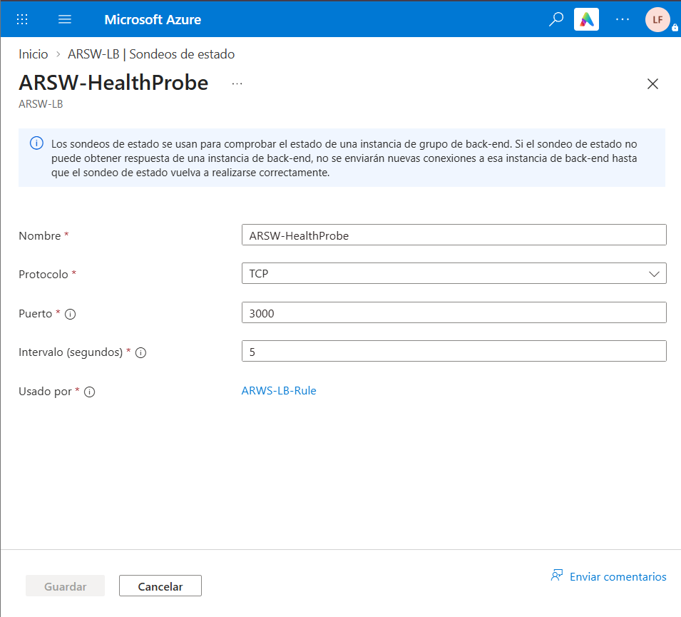

## 6. Load Balancing Rule y persistencia de sesión

La **Load Balancing Rule** conecta la IP y puerto de entrada con el backend y puerto de destino:

```text
Frontend: ARSW-LB-Frontend
Protocolo: TCP
Puerto frontend: 80
Backend pool: ARSW-BackendPool
Puerto backend: 3000
Health Probe: ARSW-HealthProbe
Persistencia: None
```

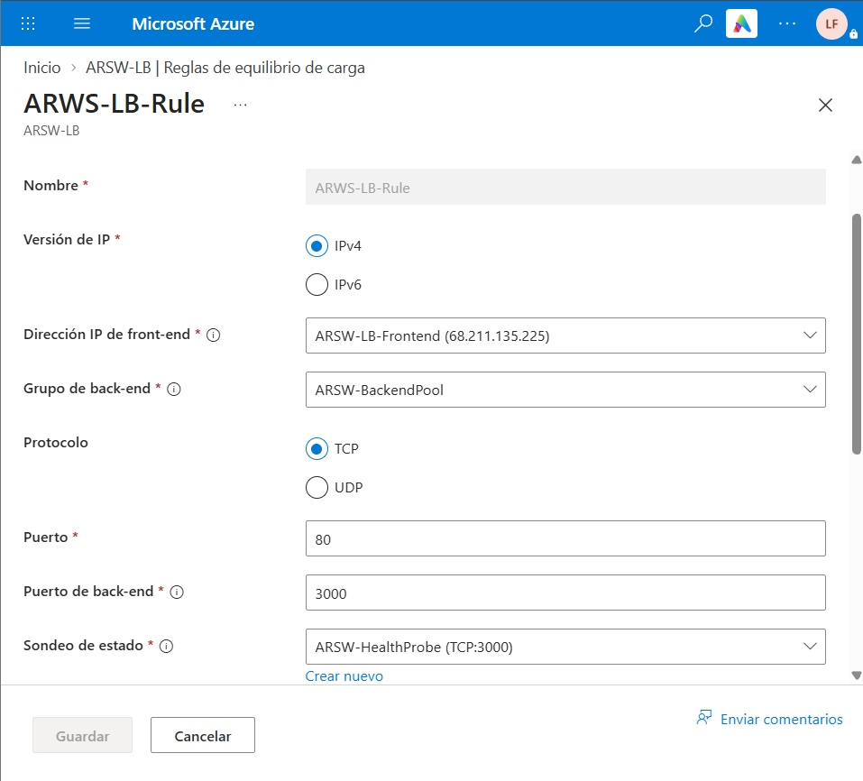

La persistencia de sesión determina si las conexiones posteriores de un cliente deben regresar al mismo backend:

- **None:** no se fija el cliente a un nodo; permite distribuir mejor la carga.
- **Client IP:** las conexiones del mismo cliente se mantienen asociadas a una instancia usando su IP.
- **Client IP and protocol:** la afinidad considera la IP del cliente y el protocolo.

Se configuró **None** porque la aplicación no mantiene sesiones de usuario ni datos de sesión en memoria. Esta configuración favorece la distribución de carga. Para una aplicación con estado local sería necesario externalizar la sesión o utilizar afinidad.

## 7. Virtual Network, Subnet y rangos de direcciones

Una **Virtual Network** es una red privada aislada dentro de Azure. `ARSW-VNet` permite que las interfaces de las VMs y los componentes de red se comuniquen usando direcciones privadas.

Una **Subnet** es una división de la red virtual. La subnet `default` contiene las interfaces de las máquinas.

- **Address space:** rango total asignado a la red virtual, por ejemplo `10.0.0.0/16`.
- **Address range de la subnet:** segmento reservado para la subnet, por ejemplo `10.0.0.0/24`.

El espacio `/16` ofrece un rango mayor y el `/24` divide una parte de ese espacio para las máquinas. La notación CIDR define cuántas direcciones pertenecen al bloque.

## 8. Availability Zones y zone-redundant

Las **Availability Zones** son ubicaciones físicas independientes dentro de una misma región de Azure, con infraestructura separada de energía, refrigeración y red. Se utilizaron tres zonas para evitar que la falla de una zona deje sin servicio a todos los nodos:

- VM1: zona 1.
- VM2: zona 2.
- VM3: zona 3.

Una IP pública **zone-redundant** puede mantenerse disponible mediante infraestructura distribuida entre zonas de la región. Esto reduce la dependencia de una única zona para el punto de entrada público.

## 9. Network Security Group

El **Network Security Group (NSG)** funciona como un filtro de tráfico para interfaces de red o subnets. En `ARSW-VM-NSG` se configuraron las reglas necesarias:

| Regla | Puerto | Propósito |
| --- | ---: | --- |
| `Allow-SSH` | 22/TCP | Administración de las VMs |
| `Allow-Fibonacci` | 3000/TCP | Acceso al servicio de Fibonacci y al health probe |

Las reglas se evalúan por prioridad. El tráfico que no coincide con una regla permitida termina bloqueado por la regla predeterminada de denegación.

## 10. Verificación de los endpoints

La ruta raíz respondió correctamente a través de la IP pública del Load Balancer:

```text
http://68.211.135.225/
```

Respuesta:

```text
Hello World
```

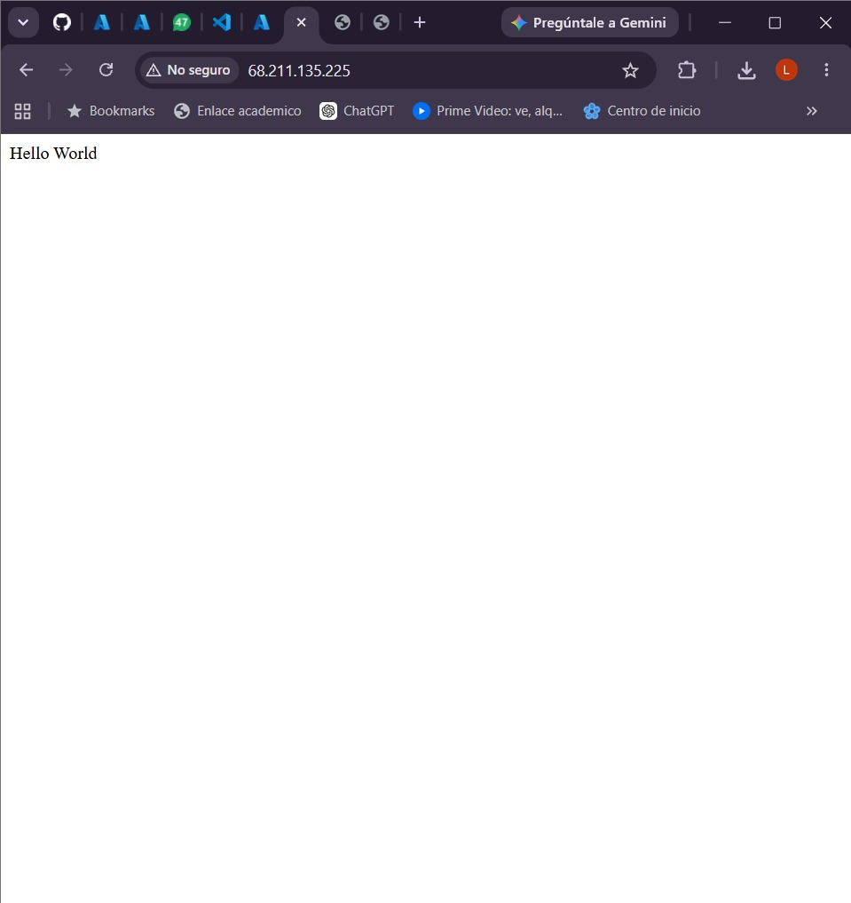

La ruta funcional también respondió correctamente:

```text
http://68.211.135.225/fibonacci/6
```

Respuesta:

```text
The answer is 8
```


Estas pruebas verifican que el tráfico externo llega al frontend del balanceador, se reenvía al backend por el puerto 3000 y alcanza la aplicación.

## 11. Informe de Newman 1

La prueba se ejecutó con la colección ubicada en `FibonacciApp/postman/part2`. La variable `loadbalancer` se configuró con la IP pública `68.211.135.225`. La petición evaluada fue:

```text
GET http://68.211.135.225/fibonacci/1000000
```

### Ejecución individual

| Métrica | Resultado |
| --- | ---: |
| Iteraciones | 10 |
| Peticiones | 10 |
| Fallos | 0 |
| Tasa de éxito | 100 % |
| Duración total | 1 min 0,7 s |
| Tiempo promedio | 5,9 s |
| Tiempo mínimo | 5,3 s |
| Tiempo máximo | 7,0 s |
| Desviación estándar | 563 ms |
| Datos recibidos | 2,09 MB |

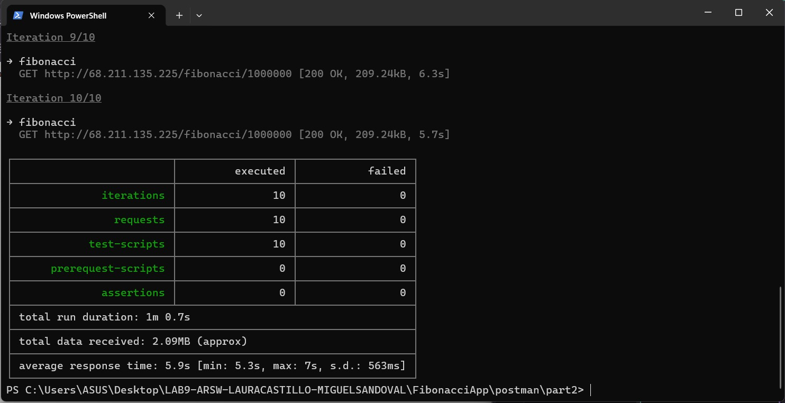

### Dos ejecuciones paralelas

| Métrica | Newman 1 | Newman 2 |
| --- | ---: | ---: |
| Iteraciones | 10 | 10 |
| Peticiones | 10 | 10 |
| Fallos | 0 | 0 |
| Tasa de éxito | 100 % | 100 % |
| Duración total | 59,3 s | 59,6 s |
| Tiempo promedio | 5,8 s | 5,8 s |
| Tiempo mínimo | 5,2 s | 5,3 s |
| Tiempo máximo | 7,1 s | 6,8 s |
| Desviación estándar | 516 ms | 508 ms |
| Datos recibidos | 2,09 MB | 2,09 MB |

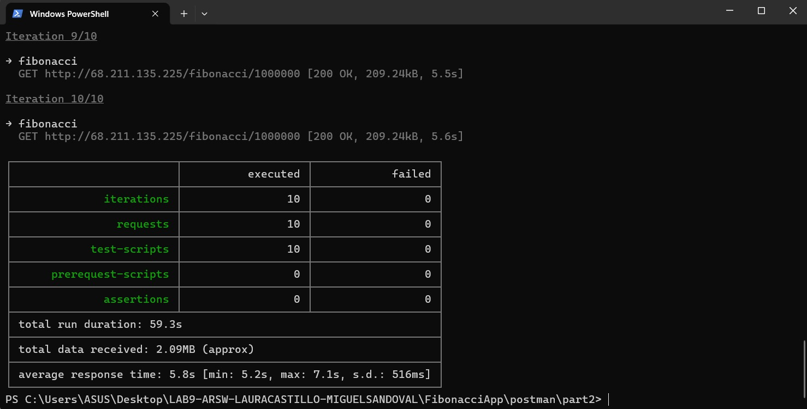

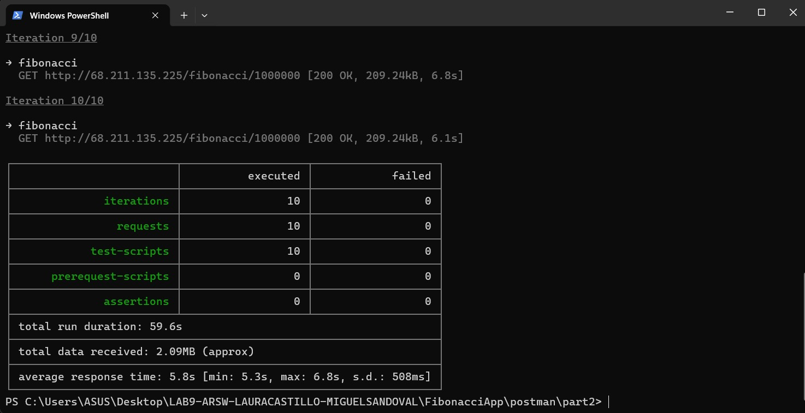

### Interpretación

En la prueba paralela se procesaron 20 peticiones y todas terminaron con código HTTP `200 OK`. La tasa de éxito fue del 100 %. El tiempo promedio fue de aproximadamente 5,8 segundos por petición y no se observaron fallos de conexión.

Frente al escenario de la parte 1 con la VM pequeña, en el que se registraron fallos bajo concurrencia, esta ejecución mostró una mayor tasa de éxito. El resultado se relaciona con la distribución de conexiones entre tres procesos independientes y con la separación de los nodos entre zonas. Al tratarse de una corrida experimental, el resultado representa esta medición y no una caracterización estadística completa.

La aplicación calcula Fibonacci de forma intensiva en CPU y cada VM ejecuta un solo proceso Node.js. El balanceador distribuye conexiones, pero no paraleliza el cálculo dentro de un mismo proceso.

## 12. Limitación de la prueba con VM4

La prueba adicional con una cuarta máquina virtual no se ejecutó. La suscripción no permitió seleccionar un tamaño disponible para VM4 en Chile Central, debido a restricciones de cuota o de disponibilidad de SKU. En consecuencia, el conjunto de resultados de este informe corresponde a la infraestructura desplegada y validada: tres VMs distribuidas en las zonas 1, 2 y 3.

## 13. Diagrama de despliegue

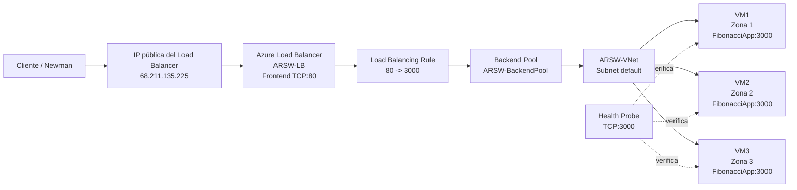

Flujo de una petición:

```text
Cliente -> IP pública del Load Balancer:80
        -> ARSW-LB
        -> ARSW-LB-Rule
        -> Backend Pool
        -> VM saludable:3000
        -> FibonacciApp
```

## 14. Comparación con el escalamiento vertical

| Aspecto | Parte 1: vertical | Parte 2: horizontal |
| --- | --- | --- |
| Unidad de escalamiento | Una VM más grande | Varias VMs |
| Punto de entrada | IP de una VM | IP estable del Load Balancer |
| Tolerancia a falla | Una VM es un punto único de falla | Los nodos se distribuyen en tres zonas |
| Concurrencia probada | La VM grande presentó fallos con cuatro Newman | 20 peticiones con dos Newman, 0 fallos |
| Mantenimiento | Cambiar tamaño puede reiniciar la VM | Se puede retirar o agregar un nodo |
| Costo | Aumenta el tamaño de una instancia | Se pagan varias instancias y el balanceador |
| Límite principal | Un proceso Node.js y un solo hilo | Cada VM aporta un proceso independiente |

La escalabilidad horizontal resulta más apropiada para este escenario porque reparte el trabajo entre instancias independientes y elimina la dependencia de una única VM. A cambio, aumenta la complejidad operativa y el consumo de recursos.

## 15. Limpieza de recursos

Para evitar consumo adicional de créditos, el grupo de recursos utilizado para la práctica es:

```text
ARSW-LAB-PARTE2
```

Esto elimina el Load Balancer, las IP públicas, la red, las VMs, discos y NIC asociadas. Antes de eliminarlo, deben conservarse las capturas y este informe como evidencia.
